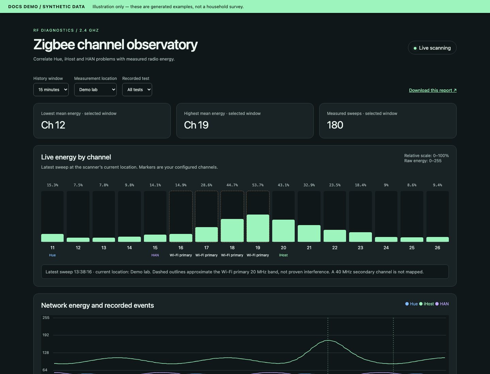

# Zigbee Observatory

**A PolyStage project · portable 2.4 GHz RF surveys with hardware you can repurpose.**

Turn a SONOFF ZBBridge-P into a channel-energy survey tool. Compare Zigbee channels with nearby Wi-Fi, keep a history of measurements, and record when devices become slow or disappear. Use the evidence to plan controlled tests around Hue, iHost, or a compatible 2.4 GHz Home Area Network (HAN).

[MIT license](LICENSE) · [Hardware](docs/HARDWARE.md) · [LEDs and button](docs/LED-STATUS.md) · [Setup and surveys](docs/USAGE.md) · [Architecture](docs/ARCHITECTURE.md) · [Troubleshooting](docs/TROUBLESHOOTING.md)

[](https://sonoff.tech/en-us/products/sonoff-zigbee-bridge-pro)

*SONOFF ZBBridge-P. Product photograph hosted by SONOFF; image rights remain with its owner. The photograph is not included in the project's MIT license. Viewing it loads an external manufacturer-hosted resource. This independent project is not affiliated with SONOFF, Signify, or a meter supplier.*

## See the radio environment, then test a hypothesis

Two Zigbee networks sharing a channel do not automatically have a problem. A large energy reading does not tell you which transmitter caused it. Zigbee Observatory helps collect the context needed for a useful comparison:

- Sweep Zigbee channels **11–26** using the CC2652P's energy-detect interface.
- Scan nearby **2.4 GHz Wi-Fi** access points, with primary channel and RSSI.
- Take Zigbee measurements with the ESP32's Wi-Fi **switched off**, then scan Wi-Fi and upload in a separate phase.
- Provision Wi-Fi from a phone over **BLE**, using a generated QR and Espressif's ESP BLE Prov app.
- Carry the bridge on USB power, mark survey points with the case button, and buffer samples while the receiver is unavailable.
- Explore channel bars, history, mean/p95/peak energy, locations, controlled tests, and timestamped failure/recovery events in a local dashboard.



[History and event comparison](docs/images/history.png) · [Mobile layout](docs/images/mobile.png)

*Documentation screenshots use clearly labelled synthetic fixtures. They contain no household measurements, network identifiers, credentials, or provisioning QR codes.*

## What is verified

| Component | Current evidence |
|---|---|
| Native ESP32 application | Builds successfully; full application flash hash verified and application boot observed |
| CC2652P radio | Hardware ping and complete 16-channel energy self-test passed |
| ESP32 Wi-Fi scanner | Hardware access-point scan passed |
| BLE setup service | Native `BLE_SETUP_READY` startup event observed |
| Receiver and analysis | Automated tests cover authentication, validation, replay deduplication, capture timestamps, and analysis |
| Phone Wi-Fi provisioning | Credentials saved in NVS; subsequent boot entered normal survey mode |
| Wireless receiver uploads | Native hardware survey accepted over Wi-Fi, with a valid capture timestamp and all sixteen channels |
| Expanded LED status implementation | Deployed to the device; physical timing/color observation still pending |
| Power-bank survey and physical button/LED behavior | Implementation present; field verification still pending |

The native path has completed a real survey and authenticated wireless upload after phone provisioning, with saved Wi-Fi credentials retained across an application update. The earlier UART/MicroPython collector also produced repeated real energy sweeps. The native portable path is under active development; the table above distinguishes implementation from demonstrated behavior.

## Get started

You need a **SONOFF ZBBridge-P**, a USB-to-UART adapter with **3.3 V logic**, USB power, a phone, and a computer on the same local network. Confirm the PCB and [board-specific wiring](docs/HARDWARE.md) before flashing. This is the ESP32 + CC2652P model; similarly named bridges can use different hardware.

```sh
python3 -m venv .venv
. .venv/bin/activate
pip install -r requirements.txt
pip install platformio==6.2.0
python configure_native.py --receiver 'http://RECEIVER-LAN-IP:8767'
pio run -d firmware-native
```

Replace `RECEIVER-LAN-IP` with the receiver computer's reachable LAN address or hostname. The quoted value is a placeholder, not a literal host to use. PlatformIO Core 6.2.0 is installed separately from the Python receiver requirements.

The configuration command creates local secrets and a BLE provisioning QR, and selects portable receiver mode. These files, builds, logs, and measurements are excluded from Git. **Do not publish the generated header, QR, or device configuration.**

Install the ESP32 application using the [flashing procedure](docs/HARDWARE.md#flashing-the-esp32). Keep the CC2652P firmware unchanged. Then start the dashboard:

```sh
python start.py
```

Open **http://127.0.0.1:8765**. The local dashboard shows the phone dashboard address, its access code, and the BLE provisioning QR. Use **ESP BLE Prov** to scan that QR and enter your 2.4 GHz Wi-Fi details. Successful provisioning restarts the unit; BLE is inactive during normal surveys.

| Case-button action | Firmware behavior |
|---|---|
| Hold for three seconds | Restart into BLE setup; the two indicator LEDs alternate |
| Short press during surveying | Mark a new numbered survey point |

See the [LED pattern table](docs/LED-STATUS.md#status-patterns) for boot, scanning, connection, upload, offline, and error indications. The expanded patterns are deployed; their physical timing/color behavior still needs field verification.

The phone camera alone does not transfer Wi-Fi credentials. See the [complete setup guide](docs/USAGE.md) for networking, timestamps, offline behavior, and a repeatable interference survey.

## Know the limits

**Energy is relative, not calibrated dBm or channel occupancy.** The chart's percentage is raw energy divided by 255. Wi-Fi RSSI is a separate measurement in dBm. Sequential channel sweeps can miss short bursts, and Wi-Fi scans occur later than the energy sweep.

The scanner does not identify individual Zigbee networks, decrypt packets, read gas consumption, commission meters, or prove why a device disconnected. Network labels come from your hub settings. It cannot observe 868 MHz HAN or 5/6 GHz Wi-Fi, and this firmware does not measure Wi-Fi channel width. Event comparisons show association and need repeated controlled tests before drawing conclusions.

The receiver is intended for a trusted local network. Its device upload token and dashboard login are useful access controls, but the current HTTP transport is not encrypted. Keep it off the public internet. [Architecture and data handling](docs/ARCHITECTURE.md) describe what is stored.

## Project layout

| Path | Purpose |
|---|---|
| `firmware-native/` | ESP32 Arduino firmware, BLE provisioning, TI framing, and portable collection |
| `scanner.py`, `portable.py` | Local dashboard service and authenticated LAN receiver |
| `observatory.py` | SQLite history, test sessions, and event comparisons |
| `dashboard/` | Browser UI with no cloud service dependency |
| `firmware/radio.py` | Earlier MicroPython UART bridge |
| `test_*.py`, `firmware-native/test/` | Receiver, analysis, and TI protocol tests |
| `docs/` | Hardware, operation, architecture, and troubleshooting |
| `data/` | Ignored local runtime data and credentials |

## Develop and contribute

```sh
python -m unittest test_portable test_observatory -q
c++ -std=c++17 -Ifirmware-native/include firmware-native/test/protocol.cpp -o /tmp/zigbee-protocol-test
/tmp/zigbee-protocol-test
node --check dashboard/app.js
```

When reporting a problem, include the bridge model, firmware revision, sanitized startup messages, and steps to reproduce. Remove Wi-Fi names/BSSIDs, device addresses, local IPs, provisioning QR codes, tokens, and meter/customer details from attachments. Share a small synthetic fixture whenever possible.

Project code and original documentation are available under the [MIT license](LICENSE). See [third-party notices](THIRD_PARTY_NOTICES.md) for dependency attribution. Third-party code retains its copyright and license notices; external product imagery retains its owner's rights. Please preserve those notices when redistributing.
