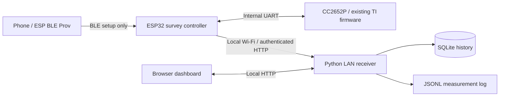
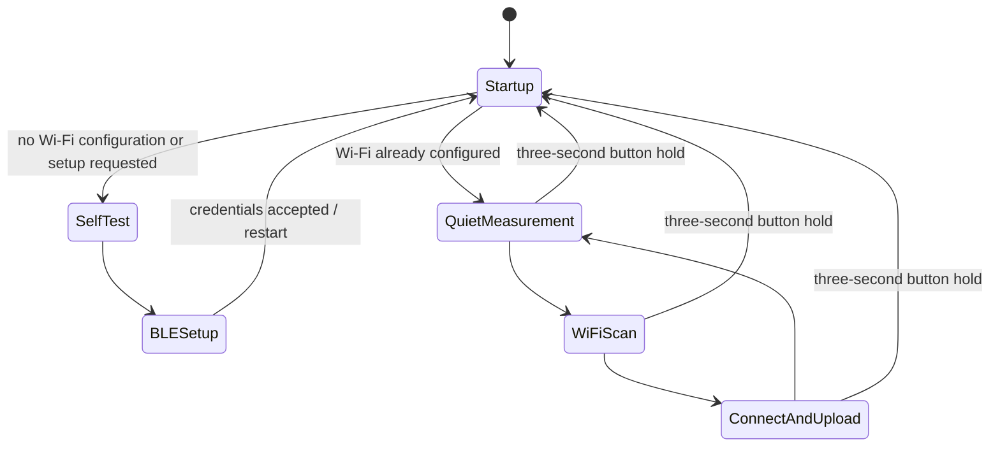

# Architecture and data handling

[Back to the project](../README.md)

## Components



The ESP32 handles provisioning, collection order, local queueing, and uploads. The CC2652P handles energy detection. The computer provides a receiver, persistent analysis, and browser UI. A phone configures Wi-Fi through Espressif's provisioning protocol and can later view the receiver's dashboard; it does not need to remain connected to BLE.

## Firmware state transitions



Normal collection disables ESP32 Wi-Fi, allows a short quiet interval, and requests a full energy sweep. It then enables station mode, scans Wi-Fi, reconnects using saved credentials, and uploads. BLE is not initialized in normal survey mode. These phases reduce interference from the scanner's own radios, but they are sequential observations rather than simultaneous spectrum measurements.

Short case-button presses increment a waypoint and clear the current test association. Receiver control updates can change the location and active test context. Each record captures its context before the sweep, so later control changes do not rewrite old samples.

## TI command interface

The internal UART uses TI's framed monitor/test protocol:

```
0xFE | payload length | command 0 | command 1 | payload | XOR checksum
```

The scanner sends `MAC_SCAN_REQ` for channels 11–26 with the energy-detect scan type. It checks both the synchronous acknowledgement and asynchronous `MAC_SCAN_CNF` result. The parser retains frames across partial reads and handles acknowledgement and callback frames arriving in a single UART chunk.

The demonstrated radio returns the legacy callback format, with energy values indexed by channel number. The parser checks callback status, scan type/page, unscanned channel mask, count, and length before mapping the sixteen readings. A packed sixteen-result layout is also accepted. Tests cover framing, fragmentation, checksum rejection, and the observed legacy layout.

The implementation does not read Zigbee network keys or issue a Zigbee network-start command. It does not provide packet capture or network attribution.

Protocol background: [Texas Instruments Z-Stack Monitor and Test API](https://e2e.ti.com/cfs-file/__key/communityserver-discussions-components-files/158/Z_2D00_Stack-Monitor-and-Test-API.pdf).

## Receiver interfaces

| Interface | Role |
|---|---|
| Loopback HTTP, port 8765 | Computer dashboard, local provisioning QR and access information |
| LAN HTTP, port 8767 | Authenticated device uploads and phone dashboard |
| `GET /api/portable/bootstrap` | Receiver time and location/test control |
| `POST /api/portable/scan` | Validated device record; upload token required |
| `GET /api/state` | Latest dashboard state |
| `GET /api/analysis` | Selected history, statistics, events, and coverage |
| `POST /api/settings` | Network/channel labels and scanner location |
| `POST /api/events` | Timestamped observations |
| `POST /api/sessions` | Start or finish a controlled test |
| `GET /api/export` | Raw measurement export |

The loopback dashboard can expose provisioning/access information because it is local to the receiver computer. The LAN dashboard uses an access-code login and a time-limited signed cookie. Device routes require a separate upload token. The receiver limits request size, validates record fields, checks capture-time plausibility, and deduplicates records by device, boot identifier, and sequence number.

These controls are designed for a trusted LAN. HTTP is currently unencrypted: a device on that network capable of observing traffic may see transmitted measurements or tokens. No internet-facing deployment is part of this project.

## Persistence

| Location | Contents |
|---|---|
| ESP32 NVS | Wi-Fi configuration and setup flag |
| ESP32 LittleFS | Bounded queued survey records |
| `data/portable-auth.json` | Receiver upload token and dashboard access code |
| `data/portable-device.json` | Device identity, receiver URL, BLE setup name, proof of possession |
| `data/provisioning-qr.png` | BLE onboarding credential |
| `firmware-native/include/device_secrets.h` | Generated private constants compiled into the application |
| `data/observatory.sqlite3` | Measurements, readings, settings, events, sessions, portable deduplication records |
| `data/scans.jsonl` | Timed measurement export log |

Wi-Fi scans can include nearby SSIDs and BSSIDs, and survey records include location labels and device network information. None of these files belong in a public source repository. Rebuilt firmware binaries also contain generated secrets and should not be shared as generic releases.

The receiver preserves unsynchronized records without inventing a wall-clock timestamp. Older buffered records enter history but do not replace a newer live measurement. Comparisons require sufficient observations in matching context; missing coverage remains visible.

## Earlier UART path

The repository retains a MicroPython UART bridge and host collector. The host loads `firmware/radio.py`, tunnels its radio connection into zigpy-znp, and issues the same energy-scan requests. This path produced repeated real sweeps before native portable work began. It requires the serial adapter throughout operation.

Portable mode selects the native device's network uploads instead and does not claim the UART port. Avoid running two serial consumers against one adapter.

## Interpretation boundaries

Raw energy is a receiver-specific scale. Transforming it into a percentage does not calibrate it. Channel statistics describe observed samples, not continuous occupancy. Wi-Fi RSSI comes from a later Wi-Fi scan and cannot be treated as simultaneous Zigbee-channel energy. Network names in the dashboard are user-supplied labels.

Changes around a logged event are associations. A useful diagnosis also considers placement, link quality, device power/battery state, firmware, commissioning, hub behavior, and the frequency band used by the affected link.
